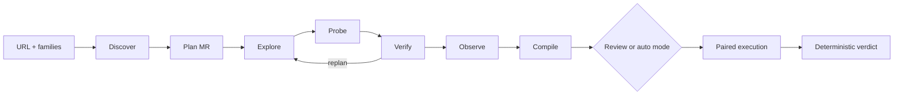

# Metamorph

Metamorph is an agentic framework for end-to-end metamorphic testing of web applications. Given a URL, a vision-language model explores the rendered page and proposes metamorphic relations. Those relations are compiled into Playwright tests and evaluated through paired executions by a deterministic engine, with no further model calls.

## Motivation

End-to-end tests check a web application the way users experience it, but deciding whether an observed outcome is correct is hard when the page depends on dynamic data, session state, or external services. This is the oracle problem. Exact assertions break when a label or layout changes, and weak ones such as "the page loaded" miss real defects.

Metamorphic testing avoids the need for an expected output by checking a relation between two related executions. A metamorphic relation (MR) defines a source execution, a transformation that yields a follow-up execution, and a property that must hold between their observations. On the web, however, writing an MR still means finding a navigable path, locating the controls, and choosing what to observe for each specific site. Metamorph automates that work for any URL supplied at test time.

Exploration covers four transformation families.

| Family | Expected relation |
| --- | --- |
| Idempotence | Repeating an action keeps the observables equal. |
| Subset | Adding a restriction does not increase the result count. |
| Permutation | Applying two independent actions in either order yields the same set. |
| Inverse | Applying an action and undoing it restores the earlier state. |

## How it works



1. **Discover.** The Playwright worker loads the page and builds a Set of Marks inventory, labelling every interactable element as `E1`, `E2`, and so on, both on the screenshot and in a textual list.
2. **Plan.** For each family, the model proposes a candidate MR and splits it into a source goal and a follow-up goal.
3. **Explore, probe, verify.** The model plans short batches of steps that reference inventory identifiers. The browser replays them and returns a fresh screenshot and inventory, and the model checks whether the goal was reached or replans. This loop is how cookie banners, modals, and login walls are handled. A smoke replay of the full path acts as a stability gate.
4. **Observe and compile.** The model binds each observable (result counts, headings, URL parts) to the final snapshot and picks a comparison allowed by the family. The compiler validates every reference and renders a Playwright specification with source and follow-up scenarios.
5. **Review.** In review mode a tester inspects the relation, the exploration timeline with screenshots and traces, and the compiled playbook, and can edit, approve, or reject it. Auto mode promotes drafts immediately.
6. **Execute.** Approved relations run as paired executions. The relation engine compares each observable and passes only if every comparison holds. Every verdict links back to its screenshots, traces, and observation values.

The design follows one principle. The LLM proposes and the rest of the system decides. The model never emits free selectors or code, and replay never calls it, so repeated runs measure the stability of the test and the application rather than the variance of the model.

## Architecture

Metamorph is a TypeScript monorepo with four applications and seven shared packages.

| Module | Responsibility |
| --- | --- |
| `apps/web` | Next.js interface for sessions, live activity, review, and run triage. |
| `apps/api` | NestJS API for session lifecycle, job orchestration, and server-sent events. |
| `apps/worker-playwright` | Page inventories, exploration probes, and paired test execution. |
| `apps/worker-llm` | LangGraph state machine that plans, explores, verifies, and observes. |
| `packages/*` | MR schemas, relation engine and compiler (`core`), Set of Marks capture (`inventory`), message contracts, promotion, session control, and the API client. |

The API and workers communicate through RabbitMQ. PostgreSQL stores sessions, jobs, MR versions, runs, verdicts, and an audit entry for every model call. Screenshots and traces go to an S3-compatible store. The model is called through OpenRouter.

## Running locally

Requirements are Node.js 22.13+, pnpm 11.5+, Docker Compose v2, and an [OpenRouter](https://openrouter.ai) API key.

```bash
cp .env.example .env          # then set OPENROUTER_API_KEY
pnpm install
docker compose up -d --build  # infrastructure and both workers
pnpm db:migrate
pnpm db:generate
pnpm dev                      # API and web app
```

Open [http://localhost:3000](http://localhost:3000), create a session with a public URL, pick the relation families, and choose review or auto mode. The model is set with `OPENROUTER_MODEL` in `.env` and defaults to `minimax/minimax-m3`, the one used in the evaluation.

## Evaluation

Metamorph was evaluated in auto mode on Amazon, Booking, Airbnb, MediaMarkt, and GitHub, with all four families and five sessions per site, for 100 exploration attempts.

| RQ | Question | Answer |
| --- | --- | --- |
| RQ1 | Can LLM-guided exploration discover and compile metamorphic relations on unseen websites, and at what cost? | Yes, in 63 of 100 attempts, at about $0.05 and 10.5 minutes per relation. |
| RQ2 | Do compiled relations replay without the LLM, and are their results stable? | 48 of 63 completed their first run in a median of 24.3 s. 16 of 35 replayed relations were fully stable. |
| RQ3 | Are the strict verdicts and the relations behind them meaningful? | 22 of 48 pairs passed. None of the 26 failures was a real defect, so human review remains necessary. |

| Result | Value |
| --- | --- |
| Relations compiled into Playwright tests | 63 / 100 |
| Compilation rate by site | 15% (Booking) to 80% (MediaMarkt) |
| Compilation rate by family | 36% (permutation) to 80% (idempotence) |
| Median exploration time per compiled relation | 10.5 min |
| Model cost per compiled relation | about $0.05 ($5.58 for the full batch) |
| Compiled tests completing their first paired execution | 48 / 63 |
| Median paired execution time | 24.3 s |
| Relations stable across three replays | 16 / 35 |
| Paired executions passing every comparison | 22 / 48 |
| Strict failures caused by a real defect in the site | 0 / 26 |

To reproduce the study with the stack running:

```bash
pnpm validation:batch -- --domain github --generation 1   # one session, or --all for the full study
pnpm validation:metrics
pnpm validation:replay
pnpm validation:summary
```

Outputs are written to [`scripts/validation/out/`](scripts/validation/out/), which already contains the data from the reported run.

## License

Metamorph is released under the [MIT License](LICENSE).

## Acknowledgements

This work was carried out as part of a Master's thesis in the Master's programme in Software Engineering at the University of Murcia.
